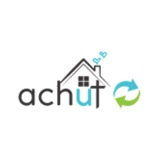

## Hey, I'm Dagus 👋

I'm a software engineer based in Nigeria. I build mobile apps, web platforms and the backends behind them, and I take them all the way to the App Store and Google Play. I studied cybersecurity and started out in security work before I moved into engineering, so I build the way an attacker would look at it: who can read this table, what happens if someone fakes this request, what a stranger could do with this endpoint.

These days I'm a **Senior Software Engineer at Brussel Lake Paragon**, where I build and ship apps for clients in the UK and across Africa. I'm also **Head of ICT at Africa Diaspora Corporation**, where I look after the servers, websites and email.

Most of my code lives in private client repos, so this page shows what's live instead.

## What I work with

  

| | |
|---|---|
| **Mobile** | Flutter and Dart, iOS and Android releases end to end, push notifications, in-app purchases |
| **Web** | React, Next.js, TypeScript, TanStack Start |
| **Backend** | Supabase (Postgres, row-level security, Edge Functions), Node.js and NestJS with Prisma, Python |
| **Payments** | Stripe, PawaPay mobile money, RevenueCat |
| **Infrastructure** | Vercel, Render, Firebase, Cloudflare, Linux servers |
| **Security** | Access control and RLS, auth, webhook verification, server hardening, incident response |

## Apps I've shipped

20 apps, live right now. Tap an icon to open the store listing.

<table>
<tr>
<td align="center" width="20%"> <b>VAR66</b> Football prediction game <a href="https://apps.apple.com/gb/app/id6757132037">iOS</a> · <a href="https://play.google.com/store/apps/details?id=com.vr.var6">Android</a></td>
<td align="center" width="20%"> <b>UK Accoms</b> Vetted UK housing <a href="https://apps.apple.com/gb/app/id6818482994">iOS</a> · <a href="https://play.google.com/store/apps/details?id=com.uk.ukaccoms">Android</a></td>
<td align="center" width="20%"> <b>Zaroba</b> Buy &amp; sell marketplace <a href="https://apps.apple.com/gb/app/id6794011088">iOS</a> · <a href="https://play.google.com/store/apps/details?id=com.brussellakeparagon.zaroba">Android</a></td>
<td align="center" width="20%"> <b>Pathly Journey</b> Life skills for young people <a href="https://apps.apple.com/gb/app/id6761062541">iOS</a> · <a href="https://play.google.com/store/apps/details?id=com.pathlyyoungster.app">Android</a></td>
<td align="center" width="20%"> <b>KickOff Padel</b> Padel for football fans <a href="https://apps.apple.com/gb/app/id6755429786">iOS</a> · <a href="https://play.google.com/store/apps/details?id=com.rivalrally.kickoffpadel">Android</a></td>
</tr>
<tr>
<td align="center"> <b>Diaspora Hub</b> Invest &amp; trade in Africa <a href="https://apps.apple.com/gb/app/id6743369761">iOS</a> · <a href="https://play.google.com/store/apps/details?id=com.thediasporahub.diasporahub">Android</a></td>
<td align="center"> <b>Front Row</b> Salon client app <a href="https://play.google.com/store/apps/details?id=digital.frontrow.client">Android</a></td>
<td align="center"> <b>Front Row Stylist</b> Tools for stylists <a href="https://play.google.com/store/apps/details?id=digital.frontrow.stylist">Android</a></td>
<td align="center"> <b>A.N.M. Money</b> Books &amp; personal growth <a href="https://apps.apple.com/gb/app/id6759561399">iOS</a> · <a href="https://play.google.com/store/apps/details?id=com.anm.anmoney">Android</a></td>
<td align="center"> <b>Achut</b> Waste removal booking <a href="https://apps.apple.com/gb/app/id6779344251">iOS</a> · <a href="https://play.google.com/store/apps/details?id=com.achutapp.achut">Android</a></td>
</tr>
<tr>
<td align="center"> <b>TIP</b> Group savings <a href="https://apps.apple.com/gb/app/id6761170289">iOS</a> · <a href="https://play.google.com/store/apps/details?id=com.tip.tipapp">Android</a></td>
<td align="center"> <b>Squaddi</b> Live events &amp; voting <a href="https://apps.apple.com/gb/app/id6759611949">iOS</a></td>
<td align="center"> <b>TopBantz</b> Football fan social <a href="https://apps.apple.com/gb/app/id6756184611">iOS</a></td>
<td align="center"> <b>Kichacha Dance</b> Dance matching &amp; events <a href="https://apps.apple.com/gb/app/id6767593498">iOS</a></td>
<td align="center"> <b>Gblaze</b> Studio bookings &amp; merch <a href="https://apps.apple.com/gb/app/id6758238517">iOS</a></td>
</tr>
<tr>
<td align="center"> <b>Digger by Day</b> Excavator hire <a href="https://apps.apple.com/gb/app/id6757637507">iOS</a></td>
<td align="center"> <b>Pathly Worker</b> For support workers <a href="https://apps.apple.com/gb/app/id6761655998">iOS</a></td>
<td align="center"> <b>Afri-Routa</b> African food &amp; fashion, UK <a href="https://play.google.com/store/apps/details?id=com.afri.routa">Android</a></td>
<td align="center"> <b>GatePass</b> Smart gate access <a href="https://play.google.com/store/apps/details?id=com.gatepass.app">Android</a></td>
<td align="center"> <b>Health Service Africa</b> Book a doctor online <a href="https://play.google.com/store/apps/details?id=com.healthserviceafrica.hsa">Android</a></td>
</tr>
</table>

**On the web:**

- [Powered By The Culture](https://poweredbytheculture.com): a news and culture publication with its own newsroom CMS.
- [Many Rooms](https://manyrooms.co): a marketplace for booking photo, video and podcast studios across the UK.
- [Salabed](https://salabed.com): a cargo and logistics company site with a real-time CMS and enquiry inbox.
- [KickOff Padel](https://kickoffpadel.club): the web side of the padel app.

## Security, in practice

Most security work never shows up in a screenshot, so here's what it looks like on real projects:

- **Incident response.** I found a production web server running a crypto miner with a root backdoor. I traced how the attackers kept getting back in (an unauthenticated login bypass in a WordPress plugin), blocked it, deleted 156 attacker-created admin accounts, and rebuilt every site and mailbox on a clean, hardened server with a cutover of under 30 minutes.
- **Payments.** On a live app taking mobile-money payments, the payment webhook believed whatever status was posted to it, so anyone could have marked a payment as completed. I rewrote it to confirm every payment with the provider's API before crediting anything.
- **Data access.** Row-level security goes on every table in the same migration that creates it, and I lock down anything the public API key could read. Clean Supabase security advisor before launch.
- **Load.** I load-test before launch day. Last one: 800 simulated users, zero errors.

B.Tech in Cybersecurity Science (Federal University of Technology, Minna) · IBM Cybersecurity Analyst · Google Cybersecurity Professional

## What I'm building now

- **Front Row**: a salon platform. The client and stylist apps are on Google Play; iOS, push notifications and the in-salon display screen come next. [Salon dashboard](https://front-row-app.vercel.app)
- **Anansi Connect**: a trade, talent and advisory platform connecting African and Caribbean businesses. Flutter on web, Android and iOS, with a React admin and a Supabase backend.
- **Emergency Tyres UK**: roadside tyre help, from request to fitter. The web app is [live](https://uk-emergency-tyres.vercel.app), and the mobile apps are on their way to the stores.
- **Zaroba**: rebuilding the marketplace app in Flutter.

## Work with me

I'm open to **remote engineering roles** and **freelance projects**: mobile apps, web platforms, Supabase and Postgres backends, and security reviews for apps that are about to launch. If you have something that needs to ship and needs to be safe, email me at **dagusansi21@gmail.com** or message me on [LinkedIn](https://www.linkedin.com/in/dagusansi).

